<div dir="rtl" align="right">

# القرآن الكريم — قارئ ومصحف المدينة النبوية للينكس

**قارئ قرآن كامل لسطح مكتب لينكس (Wayland / Hyprland / Quickshell)** — يعرض **٦٠٤ صفحة من طبعة مصحف المدينة النبوية الرسمية** بالرسم العثماني، صفحتين متجاورتين كما في المصحف المطبوع، مع بحث عربي ذكي، فهرس كامل (سور · أجزاء · أحزاب · أرباع · صفحات)، وعلامات حفظ لمواضع التوقف.

مصحف · قرآن · قارئ قرآن · مصحف المدينة · الرسم العثماني · تطبيق قرآن للينكس · بحث في القرآن · القرآن الكريم كامل

Quran reader for Linux · Madinah Mushaf · Uthmani script · Quickshell / QML desktop app

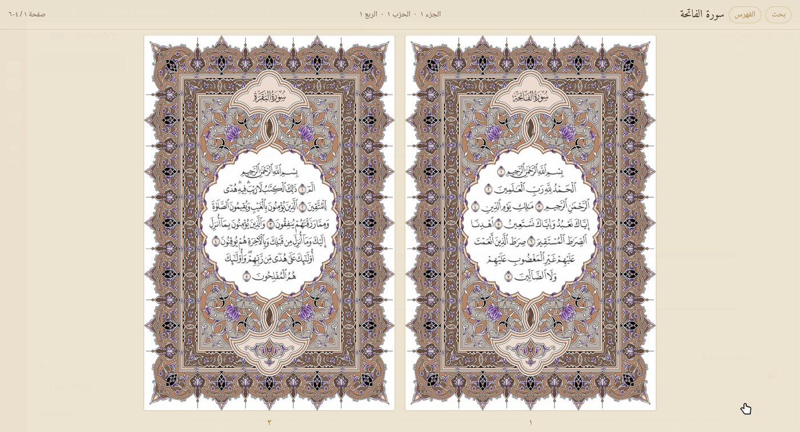

</div>

<div dir="rtl" align="right">

## المزايا

- **نفس المصحف بالضبط**: ٦٠٤ صفحة من طبعة مصحف المدينة النبوية (مجمع الملك فهد — مصحف حفص) بإطارها المزخرف، وترقيم الصفحات مطابق للمطبوع (الفاتحة ص١، البقرة ص٢، آية الكرسي ص٤٢، الناس ص٦٠٤ — تم التحقق آية بآية).
- **صفحتان متجاورتان** مثل المصحف المفتوح: الفردية يمينًا والزوجية يسارًا، مع أرقام الصفحات.
- **شريط معلومات حي**: السورة والجزء والحزب والربع والصفحة الحالية، يتحدث لحظيًا مع كل تقليب.
- **بحث عربي**: اكتب أي كلمة من القرآن (بدون تشكيل)، اسم سورة، حرفًا، أو رقم صفحة — ثم اختر النتيجة فينقلك مباشرة إلى الصفحة ويضع علامة ذهبية على موضع الآية نفسها، مع معالجة كاملة للتشكيل (ة/ه، أ/ا، ى/ي...).
- **فهرس كامل** بتبويبات (Ctrl+G): السور (١١٤) · الأجزاء (٣٠) · الأحزاب (٦٠) · الأرباع (٢٤٠) · الصفحات (٦٠٤) · علامات الحفظ — يفتح دائمًا على موضع قراءتك الحالي.
- **وضع التسميع** (`Ctrl+T`) — تجريبي: اقرأ بصوتك فيتابعك التطبيق كلمةً كلمة على صفحة المصحف نفسها ويعلّم أخطاءك ويكشف خلط المتشابهات، مع قلب تلقائي للصفحات وعلامة «آخر تسميع». التفاصيل في [قسم وضع التسميع](#وضع-التسميع-تجريبي).
- **علامات الحفظ**: علّم أي صفحة أو آية بزر «علامة» أو `Ctrl+B` — تظهر شريطة ذهبية على الصفحة، وتُحفظ في تبويب العلامات للرجوع إليها أو حذفها في أي وقت.
- **تقليب سهل**: انقر على يمين أو يسار الشاشة، الأسهم، عجلة الفأرة، أو المسافة — مع تلميحات شبه شفافة تظهر عند مرور المؤشر.
- **يستعيد آخر صفحة** تلقائيًا عند إعادة الفتح.
- **خفيف وأصلي**: مبني بـ Quickshell و QML (Qt 6) — بدون متصفح أو Electron، سريع الاستجابة ومتناسق مع Hyprland.

## لقطات الشاشة

| البحث مع علامة الآية | فهرس الأجزاء والأرباع |
|---|---|
| 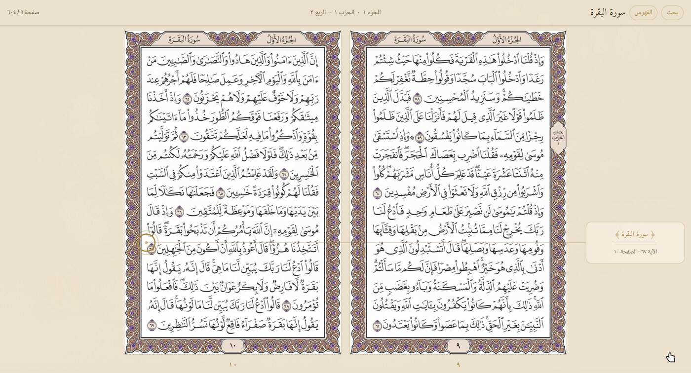 | 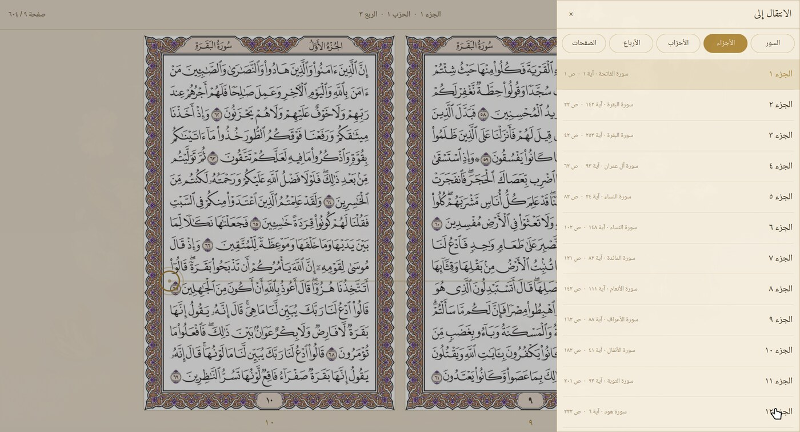 |

| علامة الحفظ | قائمة العلامات |
|---|---|
| 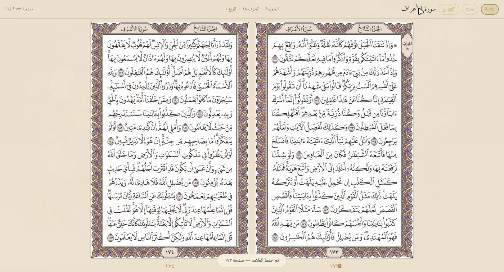 | 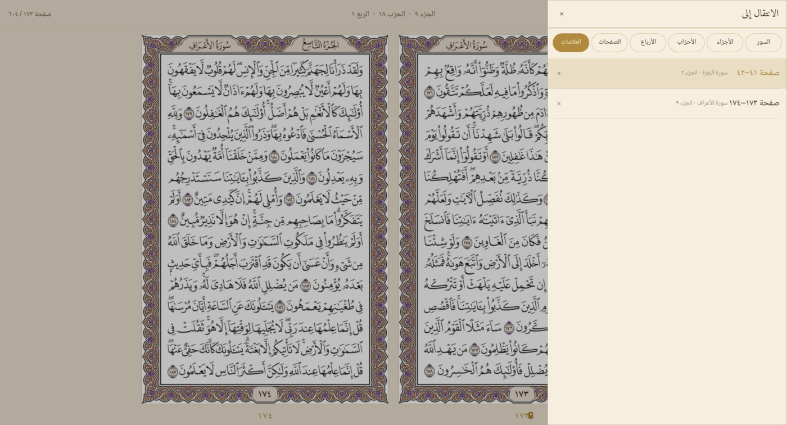 |

## وضع التسميع (تجريبي)

اقرأ من حفظك بصوتك، والتطبيق يتابعك كلمةً كلمة على صفحة مصحف المدينة نفسها (مرسومة من البيانات بخط الصفحة، مطابقة للمطبوع)، ويعلّم أخطاءك أولًا بأول. يُفتح بـ `Ctrl+T` أو زر «تسميع» في الشريط العلوي.

- **متابعة كلمة بكلمة**: الكلمة الحالية مظللة بالذهبي، والصفحة **تُقلب تلقائيًا فور نطق آخر كلمة** في الصفحتين المعروضتين. ولو قلبت بنفسك لصفحة أخرى لا يسحبك التطبيق حتى تعود للقراءة.
- **تعليم الأخطاء**: الكلمة الخطأ (أحمر)، والناقصة (برتقالي)، والزائدة، والمقطع المتخطّى، مع قائمة بالأخطاء في اللوحة الجانبية. وزر **«مسح الأخطاء»** يمسح القائمة والتظليل بتأكيد بسيط، والتسميع مستمر.
- **المتشابهات**: لو خلطت بين آيتين متشابهتين ينبّهك ويعرضهما جنبًا إلى جنب مع تظليل الفرق. ونقرة على أي كلمة تعرض متشابهات آيتها.
- **أوضاع التسميع**: تسميع حر من أي موضع، أو مقطع محدد: صفحة، أو صفحتان، أو من آية إلى آية، أو سورة، أو ربع، أو حزب.
- **إخفاء الآيات** للحفظ: الكلمات تظهر وأنت تقرؤها.
- **ملخص لكل جلسة وسجل للجلسات**: المدة، والآيات، والأخطاء حسب نوعها، وأكثر المواضع أخطاءً.
- **علامة «آخر تسميع»**: الآية التي توقفت عندها تُظلَّل بلون ذهبي خفيف مع شريطة، في وضع التسميع وفي المصحف العادي، وتظهر أولًا في تبويب العلامات. وهي علامة واحدة تُستبدل مع كل تسميع جديد، ولا تمس علاماتك العادية.
- **على جهازك بالكامل**: الصوت لا يُرسل لأي مكان، ويعمل بلا إنترنت بعد التجهيز الأول. لا يقيّم التجويد أو النطق.

**التشغيل:**

```bash
sudo pacman -S nodejs npm      # Node.js ‏20.12 أو أحدث
tools/setup-tasmee.sh          # مرة واحدة: محرك التسميع + خطوط الصفحات (~٩٥ ميجابايت)
qs -p "$PWD/shell.qml"         # ثم Ctrl+T
```

أول مرة يُنزَّل نموذج الاستماع (~٧٠ ميجابايت) إلى `~/.cache/tilawa`، وبعدها يعمل بلا إنترنت. ولو لم تشغّل `tools/setup-tasmee.sh` يجهّز التطبيق نفسه تلقائيًا عند أول فتح لوضع التسميع. يحتاج ميكروفونًا يعمل عبر PipeWire أو PulseAudio. تفاصيل التصميم والاختبارات في [docs/tasmee.md](docs/tasmee.md).

| متابعة كلمة بكلمة | الأخطاء والمتشابهات |
|---|---|
| 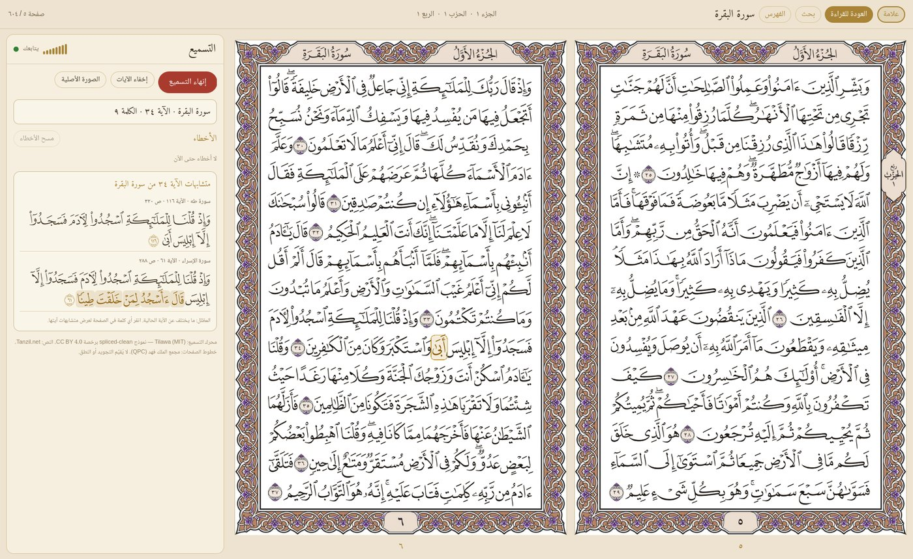 | 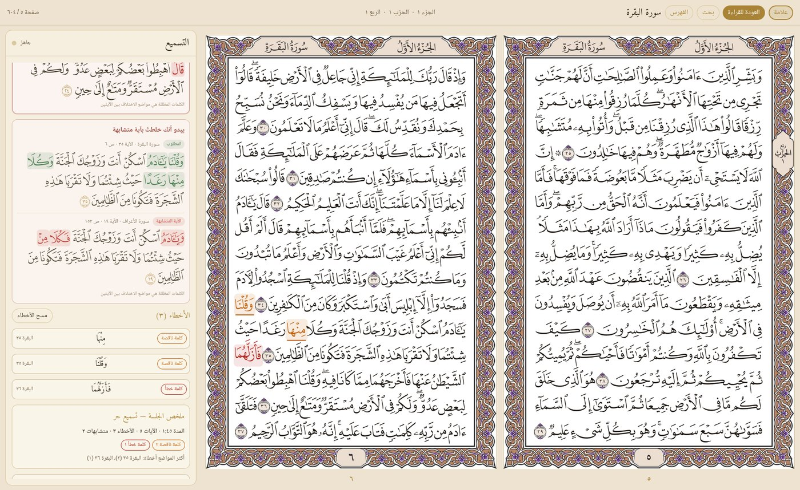 |

| مسح الأخطاء (بتأكيد) | إخفاء الآيات |
|---|---|
| 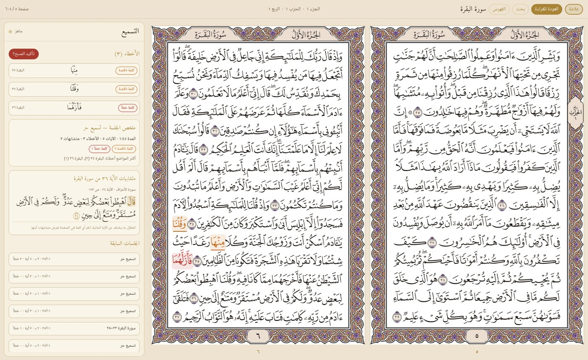 | 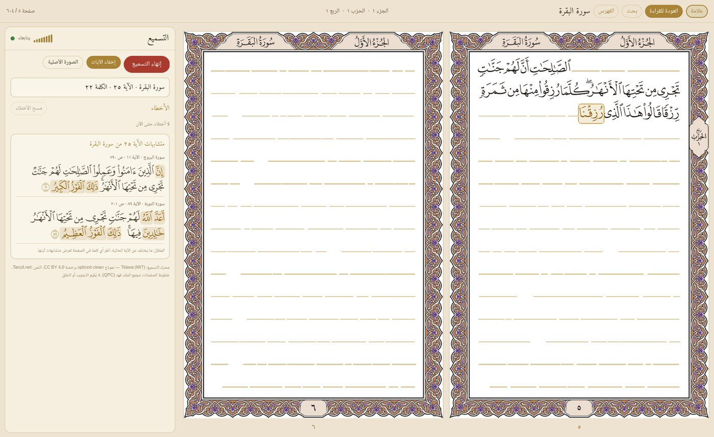 |

| «آخر تسميع» في المصحف العادي | «آخر تسميع» في وضع التسميع |
|---|---|
| 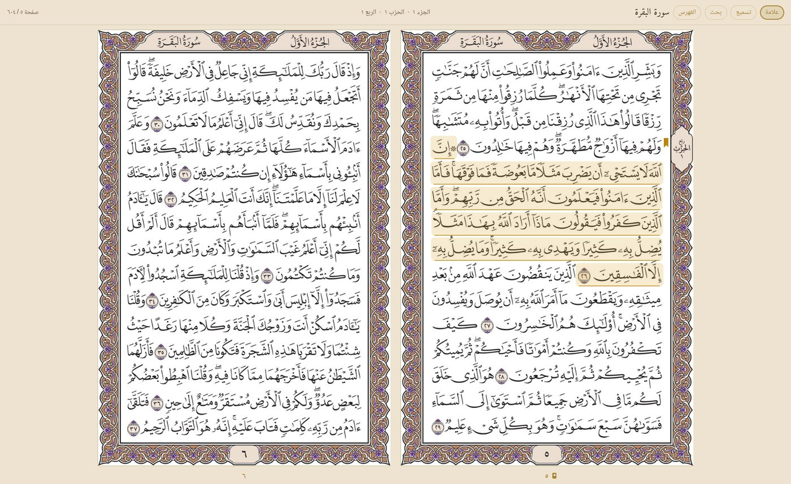 | 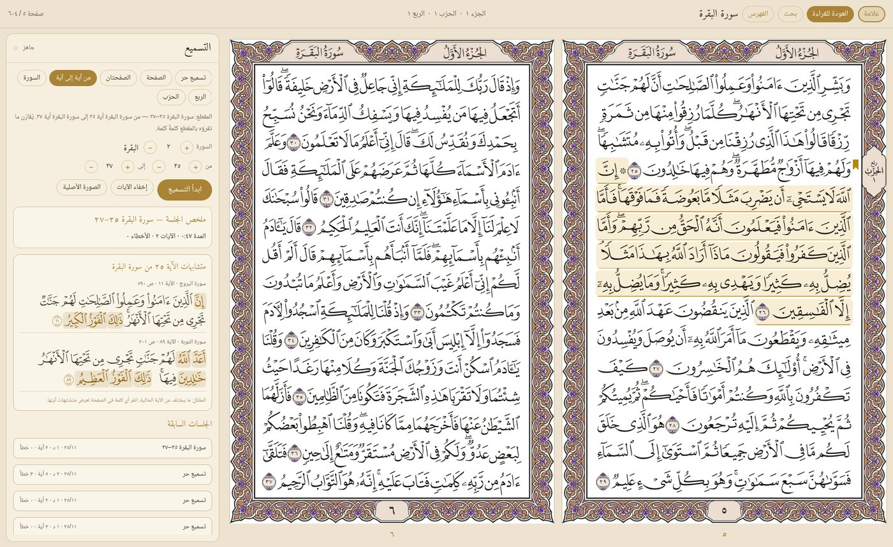 |

| «آخر تسميع» في العلامات |
|---|
| 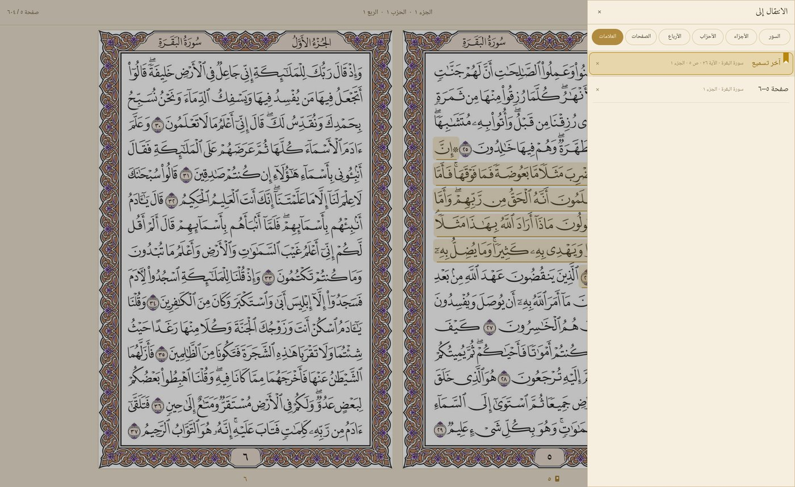 |

## التركيب

المتطلبات: لينكس بواجهة Wayland (نوصي Hyprland)، وحزمة [Quickshell](https://quickshell.org) ‏0.3+ و Qt 6.6+.

**على Arch Linux — ثلاث طرق:**

**١) حزمة جاهزة مباشرة** (الأسرع):

```bash
wget -q https://github.com/karem505/alquran/releases/latest/download/alquran-1.0.0-1-any.pkg.tar.zst
sudo pacman -U alquran-1.0.0-1-any.pkg.tar.zst
alquran    # التطبيق يحمّل صفحات المصحف تلقائيًا عند أول تشغيل
```

**٢) مستودع pacman خاص** (تحديثات تلقائية مع `pacman -Syu`) — أضف إلى `/etc/pacman.conf`:

```ini
[alquran]
SigLevel = Optional TrustAll
Server = https://karem505.github.io/alquran/x86_64
```

ثم:

```bash
sudo pacman -Sy alquran
```

> الـAUR: ملف الحزمة (PKGBUILD) جاهز في مجلد `packaging/` وستُرفع الحزمة إلى AUR فور إعادة فتح تسجيل الحسابات الجديدة هناك.

**٣) أو من المصدر مباشرة:**

```bash
# 1) استنساخ المستودع
git clone https://github.com/karem505/alquran.git
cd alquran

# 2) تنزيل صفحات المصحف (٦٠٤ صفحة، ~١٧٠ ميجابايت — مرة واحدة)
tools/fetch-pages.sh

# 3) إنشاء اختصار التطبيق في قائمة البرامج (اختياري)
tools/install-desktop.sh

# 4) التشغيل
qs -p "$PWD/shell.qml"
```

على Arch: `sudo pacman -S quickshell qt6-declarative` ثم اتبع الخطوات أعلاه. وبعد التثبيت ستجد التطبيق باسم **«القرآن الكريم»** في قائمة البرامج.

## اختصارات المفاتيح

- `Ctrl+F` — البحث في القرآن
- `Ctrl+G` — الفهرس (سور / أجزاء / أحزاب / أرباع / صفحات / علامات)
- `Ctrl+B` — حفظ / إزالة علامة موضع القراءة الحالي
- `Ctrl+T` — وضع التسميع (انظر «وضع التسميع» أعلاه)
- `F11` — ملء الشاشة · `Esc` — إغلاق النوافذ المنبثقة
- الأسهم أو مسافة — تقليب الصفحات · `Home` / `End` — أول المصحف / آخره
- وداخل الفهرس: الأرقام `١`–`٦` أو الأسهم للتنقل بين التبويبات

## البيانات والمصادر

- **صور الصفحات**: طبعة مصحف المدينة النبوية الرسمية (مجمع الملك فهد لطباعة المصحف الشريف) — حقوق الطبعة محفوظة للمجمع، وتُستخدم هنا للعرض الشخصي غير التجاري. تُنزَّل عبر `tools/fetch-pages.sh` من [QuranHub/quran-pages-images](https://github.com/QuranHub/quran-pages-images) (غير مُضمَّنة في المستودع).
- **النص العثماني**: [Tanzil.net](https://tanzil.net) (نص مصحف المدينة).
- **ترقيم الصفحات والجزء/الحزب/الربع**: بيانات [AlQuran Cloud](https://alquran.cloud) وموسوعة القرآن المفتوحة (QUL).
- **إحداثيات الآيات على الصفحات**: مستودع QuranHub (quran-pages-images).

جميع البيانات المُشتقَّة الجاهزة موجودة في مجلد `data/`، والسكربتات في `tools/`.

## التقنيات

Quickshell · QML (Qt 6) · Wayland / Hyprland — تطبيق مكتبي أصلي بلا متصفح، بواجهة عربية RTL كاملة وخطوط مصحفية.

## الإسنادات والتراخيص

**وضع التسميع:**

- **محرك التسميع**: [Tilawa](https://github.com/yazinsai/tilawa) (`@tilawa/core`) برخصة MIT. يعمل بـ [ONNX Runtime](https://onnxruntime.ai) (MIT).
- **نموذج الاستماع**: `spliced-clean` برخصة [CC BY 4.0](https://creativecommons.org/licenses/by/4.0/). مدرَّب على بيانات tlog (Tarteel) و Quranic Universal Ayahs (QUD Technologies)، ومُقطَّر من muaalem (MIT). يُنزَّل من مصدره عند أول تشغيل ولا يُضمَّن في المستودع.
- **النص العثماني وترقيم الكلمات**: [Tanzil.net](https://tanzil.net)، والنص منقول حرفيًا دون تعديل.
- **تخطيط الصفحات كلمةً كلمة**: [Quranic Universal Library (QUL)](https://qul.tarteel.ai) عبر Quran.com API، وفق شروط QUL.
- **خطوط الصفحات**: خطوط مصحف المدينة QPC V2 من مجمع الملك فهد لطباعة المصحف الشريف، وتُستخدم وفق شروط المجمع وQUL. تُنزَّل عبر `tools/fetch-qpc-fonts.sh` ولا تُضمَّن في المستودع.

الإسناد نفسه يظهر أيضًا في أسفل لوحة التسميع داخل التطبيق.

## الترخيص

الكود: [MIT](LICENSE). الصور والبيانات: وفق شروط مصادرها المذكورة أعلاه.

</div>
